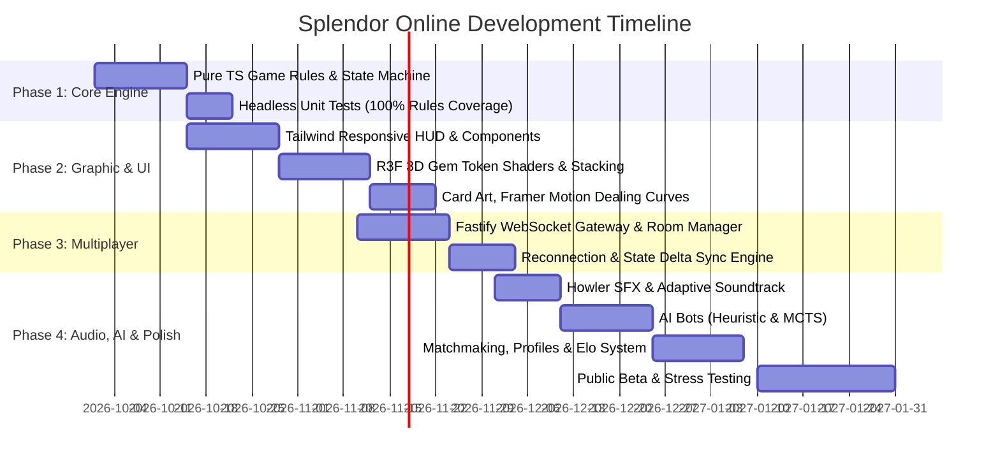

# Product Requirements Document (PRD)
## Project: *Splendor Online* — High-Fidelity Turn-Based Multiplayer Board Game

---

## 1. Executive Summary & Vision

### 1.1 Executive Summary
*Splendor Online* is a modern, web-native digital adaptation of the award-winning board game **Splendor** (designed by Marc André). Built on a cutting-edge React frontend paired with WebGL/React Three Fiber for stunning physical rendering, the game delivers tactile, jewel-like visual luxury alongside seamless real-time turn-based multiplayer. Players assume the role of wealthy Renaissance jewel merchants vying to acquire gem mines, trade routes, storefronts, and aristocratic patronage to achieve 15 prestige points.

### 1.2 Vision Statement
> *"Transforming the timeless strategy of table-top Splendor into a visually mesmerizing, tactile, and frictionless digital multiplayer experience accessible directly through modern web browsers without compromises in performance or graphic fidelity."*

### 1.3 Core Pillars
1. **Mesmerizing Visual & Tactile Immersion**: WebGL-powered 3D gem chips with subsurface scattering, physics-based stacking, dynamic lighting, high-resolution renaissance card art, and rich particle effects.
2. **Deterministic & Authoritative Multiplayer**: Server-authoritative game state machine with zero client-side cheating, automated reconnection, spectator modes, and sub-100ms round-trip latency.
3. **Frictionless Onboarding & Play**: Instant room join codes, matchmaker, solo mode against heuristic/MCTS AI, and cross-platform desktop/tablet/mobile responsive layout.
4. **Competitive & Social Layer**: Turn timers, Elo-ranked matchmaking, in-game expressive emotes, post-match analytics graph, and move replay logs.

---

## 2. Target Audience & Personas

| Persona | Demographics & Playstyle | Needs & Frustrations | Value Proposition |
| :--- | :--- | :--- | :--- |
| **"The Competitive Strategist" (Julian, 29)** | Board game enthusiast, ranked chess/Catan player, seeks depth and efficient engine-building. | Frustrated by slow UI animations, ambiguous turn rules, or unfair desyncs. | Instant action validation, move log, turn timer (Blitz / Rapid / Classical), Elo ranking. |
| **"The Casual Boardgamer" (Elena, 34)** | Plays games with friends/family remotely on Friday evenings via Discord. | Hates complex installs, account walls, clunky interfaces. | 1-click room invite links, clean intuitive UI, pass-and-play local mode, spectator link. |
| **"The Aesthetics & Sensory Gamer" (Marcus, 24)** | Loves polished indie games (e.g., *Hearthstone*, *Dorfromantik*, *Wingspan digital*). | Bored by flat 2D spreadsheet-like digital board game clones. | Heavy-weight ceramic chip clinks, glowing gem shaders, parallax card depth, cinematic victory screens. |

---

## 3. Game Rules & Mechanics Specification

To guarantee 100% faithful mechanics to the official *Splendor* board game:

### 3.1 Components & Inventory

#### 3.1.1 Gem Tokens & Gold
* **5 Regular Gem Colors**: Emerald (Green), Sapphire (Blue), Ruby (Red), Diamond (White), Onyx (Black).
* **1 Wild Token**: Gold Joker (Yellow).
* **Bank Token Counts by Player Count**:
  * **4 Players**: 7 of each regular gem (35 total) + 5 Gold (40 total).
  * **3 Players**: 5 of each regular gem (25 total) + 5 Gold (30 total).
  * **2 Players**: 4 of each regular gem (20 total) + 5 Gold (25 total).
  * *(Gold tokens are always 5 regardless of player count).*

#### 3.1.2 Development Cards
* **90 Cards Total**, divided across 3 Tiers:
  * **Tier 1 (Green back)**: 40 cards (inexpensive, foundation bonuses, 0–1 points).
  * **Tier 2 (Yellow back)**: 30 cards (medium cost, 1–3 points).
  * **Tier 3 (Blue back)**: 20 cards (expensive endgame powerhouses, 3–5 points).
* **Grid Display**: Exactly 4 face-up cards displayed per tier at all times (12 face-up cards on the board), with draw decks next to each row.

#### 3.1.3 Noble Tiles
* **Total Pool**: 10 distinct historical noble tiles (each provides **3 Prestige Points**).
* **Setup Count**: Number of players + 1 (e.g., 5 nobles for 4 players, 4 nobles for 3 players, 3 nobles for 2 players).
* **Requirements**: Fixed set of development card bonuses (e.g., 4 Diamonds + 4 Sapphires, or 3 Rubies + 3 Onyx + 3 Emeralds).

---

### 3.2 Turn Actions & Constraints

On their turn, an active player **must execute exactly ONE** of the following four primary actions:

```mermaid
flowchart TD
    Start([Active Player Turn]) --> ActionChoice{Choose Exactly 1 Action}
    
    ActionChoice -->|Action 1| Take3Diff["Take 3 Gem Tokens of Different Colors<br/>(Allowed only if distinct non-gold colors available)"]
    ActionChoice -->|Action 2| Take2Same["Take 2 Gem Tokens of Same Color<br/>(Allowed ONLY if stack has >= 4 tokens)"]
    ActionChoice -->|Action 3| Reserve["Reserve 1 Card + Take 1 Gold<br/>(From 12 face-up or top of any tier deck;<br/>Gold added if bank > 0; Hand limit: 3 cards)"]
    ActionChoice -->|Action 4| Purchase["Purchase 1 Card<br/>(From 12 face-up or player's reserved hand;<br/>Cost reduced by permanent player gem bonuses)"]

    Take3Diff --> TokenLimitCheck
    Take2Same --> TokenLimitCheck
    Reserve --> TokenLimitCheck
    Purchase --> NobleCheck

    TokenLimitCheck{"Total Tokens > 10?"}
    TokenLimitCheck -->|Yes| DiscardPhase["Select and Discard Excess Tokens<br/>back to Bank until Total = 10"]
    TokenLimitCheck -->|No| NobleCheck
    DiscardPhase --> NobleCheck

    NobleCheck{"Eligible for Noble Patronage?"}
    NobleCheck -->|Yes (Single Match)| AutoNoble["Noble automatically visits player (+3 pts)"]
    NobleCheck -->|Yes (Multiple Matches)| ChooseNoble["Player chooses 1 noble to receive this turn"]
    NobleCheck -->|No| EndTurn([Pass Turn to Next Player])
    AutoNoble --> EndTurn
    ChooseNoble --> EndTurn
```

#### 3.2.1 Action 1: Take 3 Different Gem Tokens
* The player selects 3 tokens of different regular colors (White, Blue, Green, Red, Black).
* *Exception*: If fewer than 3 colors remain in the bank, the player may take 2 or 1 distinct tokens if no other legal selection exists.
* Cannot pick Gold.

#### 3.2.2 Action 2: Take 2 Gem Tokens of the Same Color
* The player takes 2 tokens of the same regular color.
* **Strict Rule**: Only valid if the bank stack of that color contains **at least 4 tokens** at the start of the action.
* Cannot pick Gold.

#### 3.2.3 Action 3: Reserve 1 Development Card (+1 Gold)
* The player picks:
  * Any 1 of the 12 face-up development cards on the board, OR
  * The top blind card from any of the 3 tier draw decks.
* The card enters the player’s private reserved hand (hidden or face-down to opponents if drawn blind; face-up to all if chosen from table).
* The player receives **1 Gold Token** from the bank if at least 1 Gold token is available (if bank has 0 gold, the card may still be reserved, but no gold is gained).
* **Hand Limit**: A player can have a maximum of **3 reserved cards** at any time. If they already hold 3, this action is disabled.
* The empty slot on the table is immediately replenished from the matching deck.

#### 3.2.4 Action 4: Purchase a Development Card
* The player purchases a face-up card from the table or one of their own reserved cards.
* **Cost Calculation**:
  $$\text{Tokens Required} = \max(0, \text{Card Cost} - \text{Permanent Gem Bonuses of that Color})$$
* **Gold Substitution**: Gold tokens act as wildcards to pay for any missing gem tokens.
* Tokens paid return to the central bank.
* The card is added to the player's tableau, immediately granting its permanent bonus and any prestige points.
* If bought from the table, the empty slot is replenished immediately.

#### 3.2.5 Token Excess Discard Rule
* At the conclusion of an action, if a player possesses **more than 10 tokens** (including Gold), they must choose and discard excess tokens back to the bank until they hold exactly 10 tokens before their turn can end.

#### 3.2.6 Noble Visits
* At the end of a player’s turn (after purchasing a card), the game checks if the player's permanent card bonuses satisfy any Noble requirements.
* If eligible for a noble, the noble visits the player and adds 3 prestige points.
* If a player qualifies for **multiple nobles simultaneously**, the player chooses which **one** noble visits them. Only 1 noble can visit per turn.
* Nobles cannot be reserved or discarded.

---

### 3.3 Endgame & Victory Determination
1. **Trigger Condition**: When any player reaches **15 or more Prestige Points**, the final round is triggered.
2. **Round Completion**: The round continues until the current cycle finishes so that **every player has taken the exact same number of turns** (i.e., ending with the player sitting to the right of the starting player).
3. **Victory Ranking**:
   - **Rank 1**: Highest Prestige Points.
   - **Tie-Breaker 1**: Fewest purchased development cards in tableau.
   - **Tie-Breaker 2**: Highest count of remaining gem tokens.
   - **Tie-Breaker 3**: Joint victory.

---

## 4. Visual Design & "Amazing Graphics" Architecture

To stand out among digital adaptations, *Splendor Online* adopts a **tactile luxury aesthetic** evoking high-end Venetian merchants, brass instruments, velvet game mats, and physically responsive 3D gemstones.

```
+-----------------------------------------------------------------------------------------+
|                                    SPLENDOR ONLINE                                      |
|  [Room: #X89K2]   [Turn 14: Julian's Turn (00:38)]   [Sound: ON]   [Settings]  [Surrender] |
+-----------------------------------------------------------------------------------------+
|                                                                                         |
|  +---------------------------+   +---------------------------------------------------+  |
|  |     NOBLE VISITOR TILES   |   |                   CARD MATRIX                     |  |
|  | [Noble 1] [Noble 2] [...] |   | Tier 3: [Deck3] [Card 3A] [Card 3B] [Card 3C] [..] |  |
|  +---------------------------+   | Tier 2: [Deck2] [Card 2A] [Card 2B] [Card 2C] [..] |  |
|                                  | Tier 1: [Deck1] [Card 1A] [Card 1B] [Card 1C] [..] |  |
|  +---------------------------+   +---------------------------------------------------+  |
|  |     CENTRAL TOKEN BANK    |                                                          |
|  |   (3D Stackable Chips)    |   +---------------------------------------------------+  |
|  |  ( )  ( )  ( )  ( )  ( )  |   |                OPPONENTS OVERVIEW                 |  |
|  |  Dia  Sap  Eme  Rub  Ony  |   | [P2: Elena (11 pts)]   [P3: Bot Hard (8 pts)]      |  |
|  |   [   Gold Joker: 4  ]    |   | Tokens: 6 | Cards: 12  | Tokens: 8 | Cards: 9     |  |
|  +---------------------------+   +---------------------------------------------------+  |
|                                                                                         |
+-----------------------------------------------------------------------------------------+
|                           ACTIVE PLAYER DASHBOARD (YOU)                                 |
|  Prestige: 13 PTS  |  Cards: 11  |  Reserved: [Card R1] [Card R2] (2/3)                 |
|  Tokens Held (7/10):  [W:2] [U:1] [G:0] [R:2] [B:1] [Gold:1]                            |
|  Bonus Discounts:     [W:3] [U:2] [G:1] [R:3] [B:2]                                     |
|  [Action Controls]:   [Take Tokens]   [Confirm Purchase]   [Emotes]   [Move Log]        |
+-----------------------------------------------------------------------------------------+
```

### 4.1 Graphic Rendering Pipeline & Stack
* **Three.js & React Three Fiber (R3F) Canvas**:
  - **Gem Token Meshes**: Heavyweight beveled ceramic tokens with realistic normal maps, metallic inlays, and procedural specular highlights.
  - **Gem Stones**: Custom fragment shader featuring **Subsurface Scattering (SSS)**, refraction indices matching authentic gems (Diamond 2.42, Emerald 1.57, Ruby 1.76, Sapphire 1.77, Onyx 1.55), and chromatic dispersion.
  - **3D Chip Stacking Physics**: Rapier or light spring-physics for realistic token drop, wobble, and stack settling when drawn or replenished.
* **HTML5 Canvas / CSS 3D Transforms (Framer Motion)**:
  - Responsive HUD overlay with backdrop-filter glassmorphism (`backdrop-blur-md bg-stone-900/80 border border-amber-500/30`).
  - Card hover tilt and parallax specular sheen responding to cursor movement (`react-parallax-tilt` or custom pointer math).
  - Smooth card-flip and dealing animations along Bézier curves from deck stacks to grid coordinates.
* **Particle & Shader FX**:
  - Shimmering particle burst upon card purchase with color corresponding to gem bonus.
  - Golden laurel wreath eruption when a Noble visits.
  - Dynamic ambient lighting: Subtle candlelight flicker illuminating the felt/wood board texture.
* **Fidelity Fallback Tier**:
  - Automatically detect device capabilities:
    - **Ultra/High (Desktop / Dedicated GPU)**: Full 60 FPS R3F 3D token stacks, SSAO, dynamic shadows, gem refraction shaders.
    - **Medium/Low (Mobile / Battery Saver)**: Optimized 2D canvas/WebGL sprites with pre-rendered gem highlights and 60 FPS CSS transforms.

### 4.2 Audio & Haptic Design
* **Sound Effects (Synthesized & High-Res Samples via Howler.js)**:
  - *Chip Clink*: Distinct clink of heavy 14g clay poker chips hitting felt or stacking onto each other.
  - *Gem Resonance*: Pure crystalline chime when a gem bonus is activated.
  - *Card Deal*: Crisp linen card slide and snap when dealt onto the board.
  - *Noble Fanfare*: Soft royal brass/harpsichord chord progression on noble claim.
  - *Turn Chime*: Unobtrusive warm bell when the turn passes to the active player.
* **Adaptive Soundtrack**:
  - Ambient Renaissance lute, cello, and soft percussion that dynamically increases in tempo/richness as players cross 10 and 14 prestige points.
* **Mobile Haptic Feedback**:
  - `navigator.vibrate([15])` upon token selection; double pulse `[20, 50, 20]` on card purchase.

---

## 5. Functional Requirements & Feature Specifications

### 5.1 Game Setup & Lobby System
* **FR-1.1 Game Modes**:
  1. **Public Matchmaking**: Quick Match (1v1 or 4-player queue using Glicko-2 / Elo rating).
  2. **Private Custom Room**: Shareable 6-character room code and direct URL invite link (`/game/room?code=SPLEND`).
  3. **Solo vs AI**: Play against 1 to 3 AI bots with configurable difficulty (Easy, Medium, Hard).
  4. **Pass-and-Play**: Single-device local multiplayer for 2–4 players with privacy curtain options.
* **FR-1.2 Room Configuration**:
  - Player Count (2, 3, or 4).
  - Turn Time Limit: Casual (No timer), Blitz (30s/turn), Standard (60s/turn), Classical (120s/turn with 5s increment).
  - Spectator Access: Allowed / Disallowed.
  - Bot Fill: Toggle to fill open slots with AI.

### 5.2 Real-Time In-Game Controls
* **FR-2.1 Interactive Token Selection**:
  - Clicking on a token stack highlights it.
  - The UI highlights valid secondary and tertiary token selections while dimming illegal picks.
  - Interactive "Take Tokens" confirm button appears once a valid combination (3 distinct or 2 same) is staged.
* **FR-2.2 Card Interaction & Affordability Indicators**:
  - Every card on the table displays an instant visual status:
    - *Affordable Now*: Bright border + pulse; shows exact tokens to be spent.
    - *Affordable with Gold*: Subtle amber indicator displaying gold requirement.
    - *Unattainable*: Greyscale cost badges with missing token count badges.
  - Hovering/clicking a card reveals two primary buttons: **Buy Card** and **Reserve Card**.
* **FR-2.3 Reserved Hand Tray**:
  - Dedicated drawer/dock displaying the player's up to 3 reserved cards.
  - Cards can be purchased directly from this dock at any time on the player's turn.
* **FR-2.4 Discard Modal**:
  - If token count > 10 after drawing tokens, an elegant interactive modal prevents turn termination until the player selects which tokens to return.

### 5.3 Social, Turn Flow & Quality of Life
* **FR-3.1 Turn Timer & Indicator**:
  - Radial glowing border around the active player's avatar.
  - Audio warning at 10s and 5s remaining.
  - If timer expires: Player automatically passes or reserves a random card / takes valid default tokens. Two consecutive timeouts trigger auto-surrender / bot replacement.
* **FR-3.2 Move History Log & Replay**:
  - Scrollable algebraic-style notation sidebar (e.g., `P1 took [Diamond, Emerald, Onyx]`, `P2 reserved Tier 3 Card #24 + Gold`, `P1 bought Card #12 (Ruby bonus) for 2D 1S`).
* **FR-3.3 Animated Emotes & Canned Chat**:
  - Renaissance-themed emotes ("Splendid!", "A shrewd trade!", "Alas!", "Curse your merchant eye!").
* **FR-3.4 Disconnection & Graceful Recovery**:
  - If a player disconnects, a 60-second countdown begins.
  - Opponents are informed via status badges (`Reconnecting...`).
  - If the player reconnects within 60s, state is reconciled immediately from the server.
  - If expired, players can choose to convert the disconnected slot to a bot or declare forfeit.

### 5.4 End Game Summary & Analytics
* **FR-4.1 Victory Podium**:
  - 1st, 2nd, 3rd, 4th place presentation with trophies and breakdown of prestige points (Cards vs Nobles).
* **FR-4.2 Analytical Match Graphs**:
  - Prestige points progression over turn index (line chart).
  - Gem engine efficiency curve: Cumulative discount bonuses vs turns.
  - Token burn vs card yield metrics.

---

## 6. Technical Architecture & Tech Stack

```mermaid
graph TD
    subgraph Client [React 19 Frontend Web Client]
        R3F[R3F / Three.js 3D Gem Canvas]
        ReactUI[Tailwind CSS + Glassmorphism UI]
        ZustandStore[Zustand Local Game Store]
        AudioEngine[Howler.js Audio System]
        WSClient[Socket.io / WebSocket Client]
        
        ReactUI <--> ZustandStore
        R3F <--> ZustandStore
        AudioEngine <-- ZustandStore
        WSClient <--> ZustandStore
    end

    subgraph Backend [Server-Authoritative Node/Bun Backend]
        WSServer[Socket.io / Fastify WebSocket Gateway]
        RoomMgr[Room & Matchmaking Manager]
        Engine[Splendor Core State Machine Engine]
        AIEngine[MCTS & Heuristic Bot Engine]
        RedisCache[(Redis: Active Matches & Session Cache)]
        PostgresDB[(PostgreSQL: Users, Stats, Match Records)]
        
        WSServer <--> RoomMgr
        RoomMgr <--> Engine
        Engine <--> AIEngine
        RoomMgr <--> RedisCache
        RoomMgr --> PostgresDB
    end

    WSClient <== Secure WebSockets WSS ==> WSServer
```

### 6.1 Frontend Stack
* **Framework**: React 19 + TypeScript (Strict mode).
* **Build Tool**: Vite (Lightning-fast HMR and optimized asset bundling).
* **State Management**: **Zustand** (lightweight, decoupled from React lifecycle for seamless 60 FPS animation sync).
* **3D Graphics & Shaders**:
  - `@react-three/fiber` + `@react-three/drei`
  - `three`
  - Custom GLSL Shaders (Subsurface scattering for gems, velvet mat floor).
* **Animation & UI**:
  - `framer-motion` (Layout animations, deck dealing, modal reveals).
  - `tailwindcss` (Utility styling, responsive grid, luxury palette: dark obsidian, royal gold, jewel tones).
  - `lucide-react` (Crisp vectors for system icons).
* **Audio**: `howler` (Sprite-based audio loading and spatial panning).
* **Network**: `socket.io-client`.

### 6.2 Backend Stack
* **Runtime & Framework**: **Node.js (LTS) or Bun** with **Fastify** (high-throughput, low latency HTTP/WebSocket server).
* **Real-time Protocol**: **Socket.io** or raw native WebSockets (`uWebSockets.js` for extreme scale).
* **In-Memory Store**: **Redis** (Stores serialized room states, pub/sub for multi-node room broadcasts, rate-limiting).
* **Database & ORM**: **PostgreSQL** + **Prisma ORM** (User profiles, Elo ratings, historical game logs, match analytics).
* **Bot Evaluation Engine**: Standalone TypeScript worker threads running minimax/MCTS algorithms to prevent blocking the event loop.

---

## 7. Data Models & State Machine Specifications

### 7.1 Core TypeScript Interfaces

```typescript
// Gem colors definition
export type GemColor = 'diamond' | 'sapphire' | 'emerald' | 'ruby' | 'onyx';
export type TokenColor = GemColor | 'gold';

export type TokenCost = {
  [K in GemColor]?: number;
};

export type TokenSupply = {
  [K in TokenColor]: number;
};

// Development Card Model
export interface DevelopmentCard {
  id: string;
  tier: 1 | 2 | 3;
  gemBonus: GemColor;
  prestigePoints: number;
  cost: Record<GemColor, number>;
  artAssetId: string;
}

// Noble Tile Model
export interface NobleTile {
  id: string;
  prestigePoints: 3;
  requirements: Record<GemColor, number>;
  artAssetId: string;
}

// Player State Representation
export interface PlayerState {
  id: string;
  username: string;
  avatarUrl: string;
  isAi: boolean;
  connected: boolean;
  tokens: Record<TokenColor, number>;
  bonuses: Record<GemColor, number>;
  cardsPurchased: DevelopmentCard[];
  cardsReserved: DevelopmentCard[];
  noblesAcquired: NobleTile[];
  prestigePoints: number;
  timeRemainingMs: number;
}

// Entire Game State (Server Authority)
export interface SplendorGameState {
  gameId: string;
  status: 'lobby' | 'in_progress' | 'final_round' | 'completed';
  turnIndex: number;
  activePlayerId: string;
  startingPlayerId: string;
  players: PlayerState[];
  bank: TokenSupply;
  decks: {
    1: string[]; // Card IDs remaining in tier 1
    2: string[]; // Card IDs remaining in tier 2
    3: string[]; // Card IDs remaining in tier 3
  };
  tableCards: {
    1: (DevelopmentCard | null)[]; // 4 slots
    2: (DevelopmentCard | null)[]; // 4 slots
    3: (DevelopmentCard | null)[]; // 4 slots
  };
  nobles: NobleTile[];
  winnerId: string | null;
  history: GameActionLog[];
  turnDeadline: number; // Unix timestamp
}
```

### 7.2 WebSocket Protocol Event Matrix

#### Client to Server (`C2S`)

| Event Name | Payload | Description |
| :--- | :--- | :--- |
| `c2s_take_distinct_tokens` | `{ colors: GemColor[] }` | Request to take 2–3 distinct tokens from bank. |
| `c2s_take_pair_tokens` | `{ color: GemColor }` | Request to take 2 tokens of the same color. |
| `c2s_reserve_card` | `{ cardId?: string, tier?: 1\|2\|3 }` | Reserve face-up card by ID OR blind draw top of tier deck. |
| `c2s_purchase_card` | `{ cardId: string, goldSubstitutions: Record<GemColor, number> }` | Buy card from table or hand, specifying gold allocation. |
| `c2s_discard_tokens` | `{ tokens: Record<TokenColor, number> }` | Return excess tokens if total exceeds 10. |
| `c2s_claim_noble` | `{ nobleId: string }` | Disambiguate which noble visits when multiple qualify. |
| `c2s_send_emote` | `{ emoteId: string }` | Send animated emote to room. |

#### Server to Client (`S2C`)

| Event Name | Payload | Description |
| :--- | :--- | :--- |
| `s2c_game_state_sync` | `SplendorGameState` | Complete authoritative state snapshot (broadcast on join/reconnect). |
| `s2c_action_resolved` | `{ action: GameActionLog, delta: Partial<SplendorGameState> }` | Delta update for animation execution. |
| `s2c_action_rejected` | `{ reason: string, errorCode: string }` | Validation error sent back to active player if move illegal. |
| `s2c_prompt_discard` | `{ excessCount: number }` | Informs player they must discard excess tokens. |
| `s2c_prompt_noble_choice`| `{ nobleIds: string[] }` | Prompts player to select from multiple eligible nobles. |
| `s2c_game_over` | `{ rankings: PodiumEntry[], stats: MatchStats }` | Endgame celebration and statistics. |

---

## 8. AI Opponent Specifications

To facilitate solo play and handle disconnected players, the game includes a 3-tiered AI architecture:

### 8.1 Bot Difficulty Tiers

```
+--------------------------------------------------------------------------------+
| TIER 1: "Apprentice" (Easy)                                                   |
| - Strategy: Greedy 1-ply evaluation.                                           |
| - Behavior: Prioritizes taking available tokens, buys affordable tier 1 cards  |
|   randomly, rarely reserves cards or plans for nobles.                        |
+--------------------------------------------------------------------------------+
| TIER 2: "Merchant" (Medium)                                                   |
| - Strategy: Weighted heuristic evaluation function.                            |
| - Behavior: Target-driven engine building. Targets specific nobles or tier 2/3 |
|   cards, accumulates matching colors, and reserves cards when opponents       |
|   are 1 turn away from purchasing them.                                       |
+--------------------------------------------------------------------------------+
| TIER 3: "Master Guildmaster" (Hard)                                            |
| - Strategy: Monte Carlo Tree Search (MCTS) / Alpha-Beta with Depth 4-5.        |
| - Behavior: Calculates tempo (turns required to acquire points), actively     |
|   denies key cards/gems needed by leading opponents ("hate-drafting"), and    |
|   optimizes Gold utilization to maximize prestige velocity.                   |
+--------------------------------------------------------------------------------+
```

### 8.2 AI Evaluation Function Variables
$$\text{Score}(S) = w_1 \cdot \text{Prestige} + w_2 \cdot \text{BonusDiversity} + w_3 \cdot \text{NobleProximity} - w_4 \cdot \text{TurnsToAffordTarget} - w_5 \cdot \text{OpponentAffordabilityPenalty}$$

---

## 9. Non-Functional Requirements (NFRs)

### 9.1 Performance & Graphics Budgets
* **Frame Rate**: Consistent **60 FPS** on standard modern hardware (Apple M1+, Intel Core i5 10th Gen+, modern mobile Safari/Chrome).
* **Asset Load Time**: Core bundle under **2.5 MB** gzipped. 3D models and textures asynchronously streamed and cached via service worker / CacheStorage.
* **Canvas GPU Footprint**: Max **150 MB** WebGL VRAM consumption. Textures compressed as WebP/KTX2.
* **Time-to-Interactive (TTI)**: Under **1.8 seconds** on standard broadband connections.

### 9.2 Real-time Latency & Scalability
* **Action Round-Trip Time (RTT)**: Under **100ms** between action confirmation and board response in the same geographic region.
* **State Reconciliation**: Optimistic client animations with authoritative server rollback in case of validation failure.
* **Concurrency**: A single standard backend node (2 vCPU, 4GB RAM) must support at least **1,000 concurrent active game rooms** using lightweight in-memory state machines.

### 9.3 Responsiveness & Accessibility
* **Device Support**: Responsive layout targeting Desktop (1920x1080, 1440x900), Tablets/iPads (1024x768), and Mobile phones (both landscape and optimized vertical scrolling layout).
* **Accessibility**:
  - Colorblind Accessibility Mode: All gem colors paired with distinct geometric iconography (Diamond = Rhombus, Sapphire = Square, Emerald = Pentagon, Ruby = Circle, Onyx = Hexagon, Gold = Star).
  - Screen-reader friendly aria-labels on card costs and bank tokens.

---

## 10. Development Roadmap & Milestones



---

## 11. Success Metrics & Key Performance Indicators (KPIs)

1. **Match Completion Rate**: $> 92\%$ of started multiplayer matches are played to completion without rage-quits or unresolved disconnects.
2. **Session Duration**: Average session duration $> 35$ minutes (indicates players stay for 2–3 consecutive games).
3. **Graphics Performance**: Less than $1\%$ of sessions report frame drops below 45 FPS.
4. **Reconnection Success**: $> 95\%$ of interrupted sessions successfully restore state within the 60-second recovery window.
5. **Day 7 Retention**: $> 38\%$ for registered players participating in matchmaking.

---

## 12. Risk Analysis & Mitigation Strategies

| Risk Description | Severity | Probability | Mitigation Strategy |
| :--- | :--- | :--- | :--- |
| **WebGL Performance Degradation on Low-End Mobile** | High | Medium | Implement an automatic performance benchmark upon initial load; gracefully fallback to lightweight CSS/Canvas 2D rendering if WebGL fails to maintain 45 FPS. |
| **State Desynchronization across Clients** | Critical | Low | Keep the game strictly server-authoritative; each event transmits a strict versioned `sequenceId`. Any mismatch triggers an instant full-state re-hydration. |
| **Copyright & IP Infringement Concerns** | High | Medium | Use original Renaissance-themed high-resolution artwork, distinct merchant lore, original card illustrations, and branded iconography to avoid trademark/copyright infringement while honoring open mathematical game mechanics. |
| **Player Griefing (Stalling Turn Timer)** | Medium | High | Enforce strict turn timers (Blitz/Standard) with automatic auto-play/forfeit on 2 consecutive timeouts; implement player blocking and karma ratings. |

---
*End of Product Requirements Document.*
